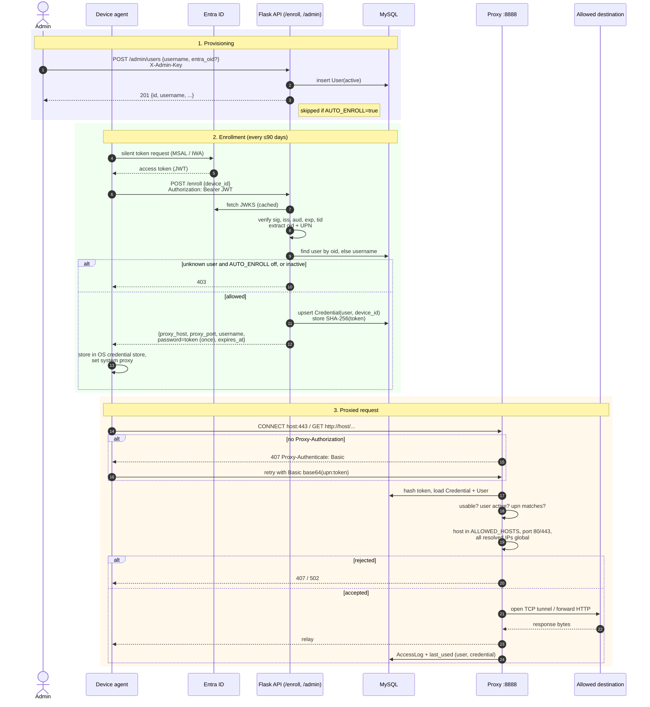
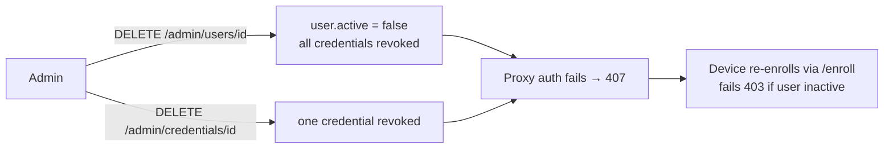

# Flow

## Overview

## Revocation

## Services (docker-compose)

- **db**: MySQL 8.4.
- **api**: gunicorn, `admin:create_app()`, bound to `127.0.0.1:8000`.
- **proxy**: `python proxy.py`, threaded forward proxy on `:8888`. Shares the Flask app and DB. Origin-form requests (e.g. `POST /enroll`) are served by Flask via `serve_local`.

## Known gaps

- `ALLOWED_HOSTS` read twice: `proxy.py` from env directly, ignoring `Config.ALLOWED_HOSTS`.
- `PUT`/`DELETE`/etc. always go through `forward_http`, so they get 407 when sent to local routes.
- `CONNECT` logs status 200 even if the tunnel fails after the handshake.
- `/enroll` and admin routes over the proxy port are plain HTTP unless TLS is terminated in front.
